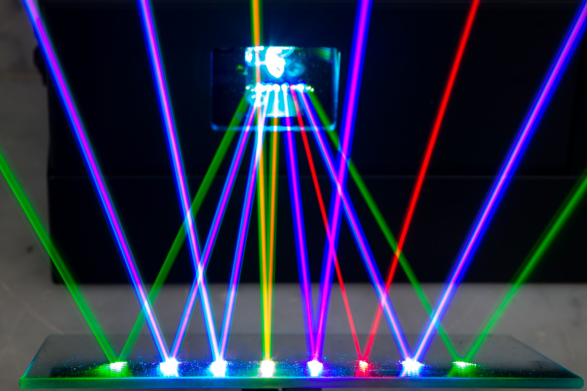
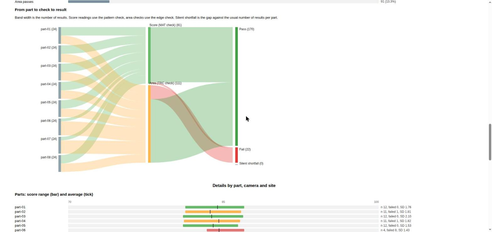

<a href="https://commons.wikimedia.org/wiki/File:Genesis_laser_harp_beam_output.jpg">
    
</a>

# Photonic Line Monitor

Photonic Line Monitor reads the process log of an optical assembly station and shows what failed, where it waited, and whether its pass marks agree with another rule. On the synthetic demo run (`make demo`) it reports 192 results, 170 passing (89%), and 22 failed checks, 15 of them boundary failures on one part.

Photonic devices are built by aligning lenses, fibres and lasers to a few micrometres, one part at a time. The station that does this writes a log line for every check. This tool turns that log into the views a production engineer needs to release a lot, find a failure mode, or spot a drifting station before it causes scrap.

It works on log files, not on optical measurements, so it does not judge device performance. It judges the process that built the device.

## What it shows

- **Log parsing:** reads a line-oriented machine log with several kinds of line, and keeps the lines it cannot use apart from the results.
- **Statistics and control limits:** mean, spread, trend and a normal range per camera and per site, taken from the first readings.
- **Streamed charts:** server-sent events push each result to the page as it is read, so the charts fill in while the file is processed.
- **A Node.js server with uploads:** one upload carries the log and an optional part names file. The server refuses to name parts it cannot verify.
- **Data validation:** a log check lists what is missing, and a mapping check compares the part names with the log before drawing the site charts.
- **Reproducible builds:** a Makefile installs a pinned Node version, picks a free port, and removes files only with an explicit confirmation.

## Hard problems and how they were solved

- **Failures counted twice.** Boundary failures appeared once as readings and once as area checks, so the totals were overstated. Each result line is now counted once, from its own source.
- **Pass marks that disagree.** The station's own verdict and a tolerance rule do not always agree. The page shows both as grids and does not decide which one is right.
- **Part names that do not match the log.** A mapping file from another run gave names that did not fit. The server now refuses to draw the site charts with names it cannot verify, and says why.
- **A dependency that broke on the target runtime.** The static file server failed on a newer Node version. The versions were pinned and the install was moved into the Makefile.

## Tests and demo

This repository holds no automated test suite at present. The checks run on the demo data, and the page reports them in the log check and the variants table.

To run the demo and see the checks:

```bash
make demo
make run
```

The variants table runs the parser on six changed copies of the log and shows which panels still work for each.

## Where it fits

- Monitoring lens, fibre and laser alignment on an assembly line.
- Packaging yield review before a lot is released.
- Finding a station that drifts or waits, before it creates scrap.
- Reviewing test and process data with the people who own the station.

## Run

```bash
make run
```

`make run` installs Node.js 8 into `.node/` if it is missing, installs the packages, and starts the server on the first free port from 8000. Use `make run PORT=8080` to choose a port.

To remove the packages, run `make clean CONFIRM=YES`. Without `CONFIRM=YES` it only prints what it would remove.

## Use

1. Choose the station's log file and, optionally, a part names file.
2. Click Upload. One upload sends both files.
3. Read the dashboard from the top down.

Without a part names file, the charts show raw image names and the site charts are not drawn. The page says so.

## The dashboard

The screenshots use the synthetic demo log. It has boundary failures, no-mark failures, stops, area checks, repeat photos and a drifting part.

### Summary and log check

The first lines give the number of results, the number that passed, the failures and where they came from, the share of the run with no results, and the longest wait for one part.


### Pass marks and line trace

Two grids compare the station's pass marks with two rules. Green cells agree. A second panel shows how each line of the log was read and which kinds of line the charts use.


### Failures over time and area checks

Passed and failed checks are counted over time, with stops and repeated failures shaded. The failure bins sort the failures by kind. Area checks are plotted against the reference area, so a rejected check shows as a dip.


### Scores by assembly site

Each chart is one assembly site, with one line per side. The shaded band is the normal range, taken from the first readings.


### Where the log goes

The flow follows each part through its checks to a pass, a fail or a shortfall against the usual number of results.



### Parts, cameras, sites and stops

Score ranges per part, camera and site, with the average marked. Stops appear as red bars on the same time line.


### Yield, heatmap and steps

Passes and fails per part, a heatmap of results in five-minute slots, and the steps each part went through, with repeat photos.


## Limits

- The tool reads one log format from one kind of station. Another station needs its own log reader.
- The log has no date and no units for its step times. The page says so and does not guess them.
- The tolerance rule is ours, not the station's. The page shows where it disagrees with the station and leaves the decision to the engineer.

## Units

The sample log gives a camera magnification of 0.0047 on both axes, and ring diameters of 0.0700 and 0.1000. It does not state a unit. Treat any size read from these values as an assumption until the equipment documentation confirms the unit.

## Stack

Node.js (version 8 in the Makefile), Express, Dygraphs for the charts, server-sent events for streaming, Python for the replay tool, and Make for the build.

## Contributing

1. Fork it.
2. Create a feature branch: `git checkout -b my-new-feature`.
3. Commit your changes: `git commit -am 'Add some feature'`.
4. Push the branch: `git push origin my-new-feature`.
5. Open a pull request.

## License

This project is released under the [MIT License](http://www.opensource.org/licenses/MIT).
