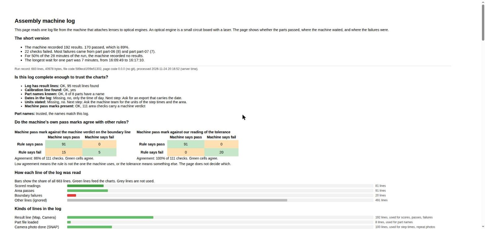
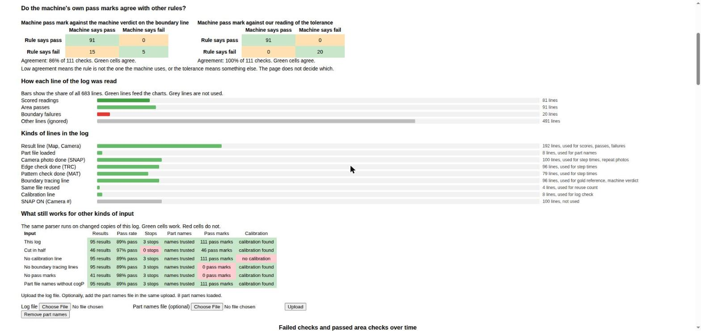
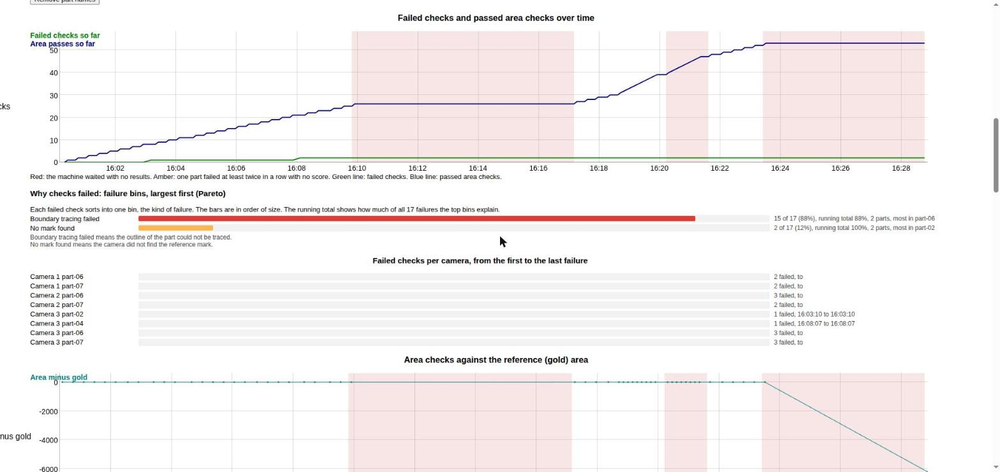
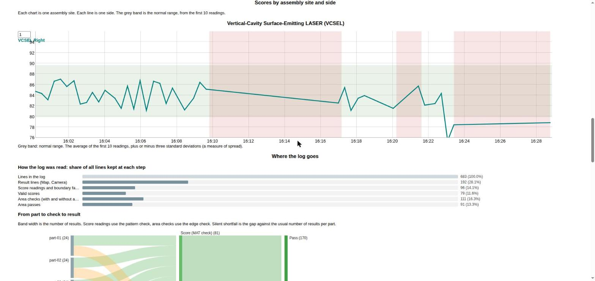
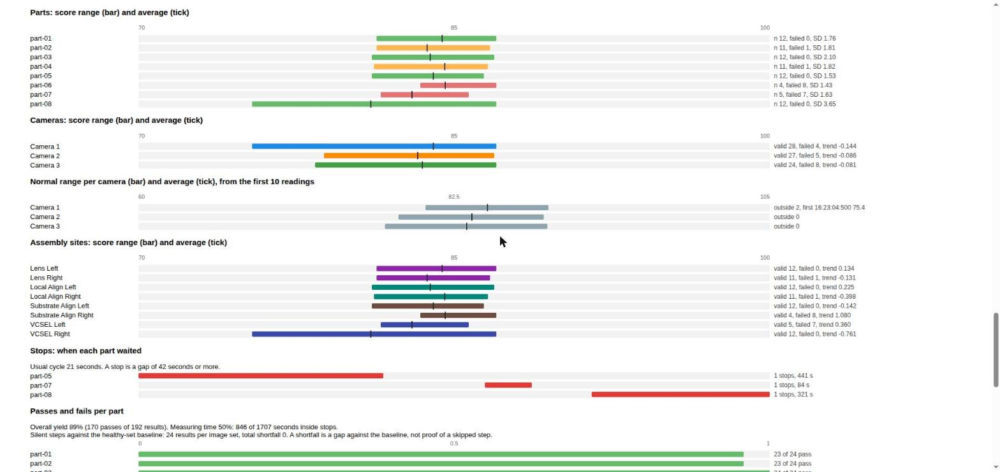
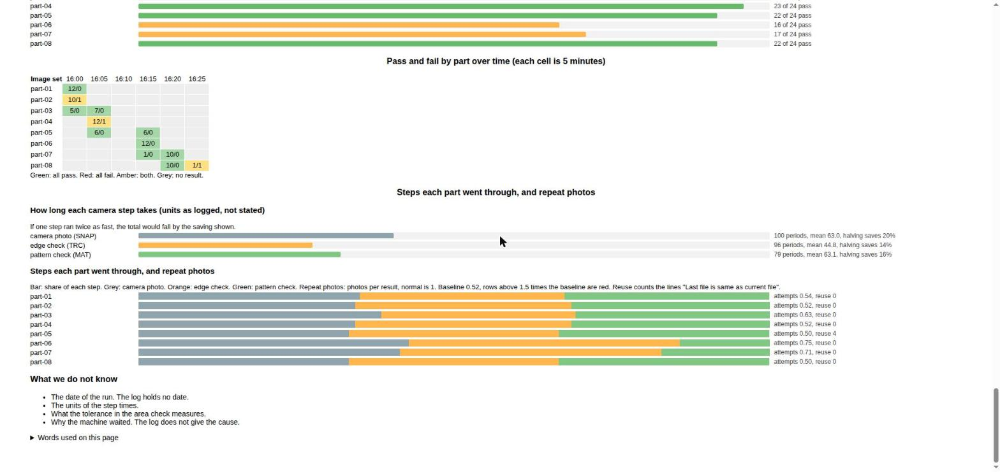

# Industrial precision visualizer

A web page that reads one log file from an assembly machine and shows what happened, part by part and over time.

The machine attaches a lens to an optical engine (a small circuit board with a laser). It scores each part against its reference image, from 0 to 100. Higher is better. The page shows whether the parts passed, where the machine waited, and where the failures were.

The charts use one shared time line, so a failure, a stop and a score can be read at the same moment.

## Run

```bash
make run
```

`make run` installs Node.js 8 into `.node/` if it is missing, installs the packages, and starts the server. It picks the first free port from 8000 and opens the page in a browser.

To choose a port:

```bash
make run PORT=8080
```

To remove the packages, run `make clean`. It prints what it would remove and removes nothing until you add `CONFIRM=YES`.

To make a synthetic log for demonstrations, run `make demo`. It writes `demo/demo.LOG` and a matching part names file. The demo holds no machine data.

## Use

1. Choose the log file and, optionally, the part names file.
2. Click Upload. One upload sends both files.
3. Read the dashboard from the top down.

The part names file says which image file is which part, for example `Lens Left`. Without it, the charts are not named and the site charts are not drawn. The page says so. To remove the part names, click Remove part names.

The machine log is private and is not in this repository.

## The dashboard

The screenshots use the synthetic demo log. It has boundary failures, no-mark failures, stops, area checks, repeat photos and a drifting part, so the charts show the kinds of events a real run produces.

### 1. The short version

Four lines sum up the run: how many results there were and how many passed, how many checks failed and where, how much of the run had no results, and the longest wait for one part.

Below them, the run record shows the number of lines read and a short code for the file, so anyone can check which file produced the page.

The log check says whether the file has what the charts need: result lines, the calibration line, part names, dates and units. A missing item says what to ask for.



### 2. Do the pass marks agree with other rules?

Two grids compare the machine's own pass mark with two rules of ours. The first uses the machine's verdict on the boundary line. The second uses our reading of the tolerance around the gold area. Green cells agree.

The page does not decide which rule is right. It shows where they differ, so an engineer can ask what the tolerance really measures.

### 3. How each line was read

Bars show how many lines became scored readings, area passes and boundary failures, and how many were ignored. The list of line kinds shows each kind of line in the log and whether the page uses it.

The variants table runs the same parser on changed copies of the log. Green cells still work. Red cells do not, for example when there is no calibration line.



### 4. Failed and passed checks over time

The blue line counts passed area checks. The green line counts failed checks. Red bands are stops, where the machine waited with no results. Amber bands are one part failing again and again.

Below the chart, the failure bins sort every failure by kind. The bars run from the largest to the smallest kind, and the running total shows how much of all failures the top kinds explain. The failed checks per camera show when each camera's failures began and ended.



### 5. Area checks against the reference

Each dot is one area check. Zero means the part matches the reference area exactly. The dips far below zero are checks the machine rejected.

The same shaded bands as the failure chart show the stops and the repeated failures, so the two charts line up.

### 6. Scores by assembly site and side

Each chart is one assembly site, and each line is one side. The grey band is the normal range, taken from the first readings. A point outside the band is unusual.

The chart title names the site. Part names come from the part names file, so the site charts show only when that file matches the log.



### 7. Where the log goes

The bars show how much of the log each step kept, from every line down to the area passes. The flow diagram follows each part through its checks to a pass, a fail or a silent shortfall. Wider bands mean more results.

A silent shortfall is a part with fewer results than the usual number. It is a gap to check, not proof that a step was skipped.


### 8. Parts, cameras and sites

Each bar is the score range of one part, camera or site, and the tick marks its average. The number on the right gives the valid readings, the failed readings and the spread.

The normal range per camera uses the first 10 readings, so a camera with a wide range shows a wide band.

The stops list shows, for each part, each gap between two checks that was at least twice the usual gap. The stops are the red bars on the same time line.



### 9. Passes and fails per part, and the time they happened

The bars show the passes out of the results for each part. The overall yield and the time the machine spent inside stops sit above them.

The heatmap shows one part in one five-minute slot. Green cells pass, red cells fail, and amber cells have both.

### 10. The steps each part went through

The bars show the share of camera photos, edge checks and pattern checks for each part. Grey is the camera photo, orange the edge check, and green the pattern check. The attempts column gives the repeat photos per result. A normal part takes one photo per result, and a part above 1.5 times the normal rate is marked red.

Reuse counts the times the machine read the same file again without loading it.



### 11. What we do not know

The page ends with what the log does not say: the date of the run, the units of the step times, what the tolerance measures, and why the machine waited. A word list at the bottom explains the terms used on the page.

## Units

The log gives a camera magnification of 0.0047 on both axes, and ring diameters of 0.0700 and 0.1000. It does not state a unit. Treat any size read from these values as an assumption until the equipment documentation confirms the unit.

## Contributing

1. Fork it!
2. Create your feature branch: `git checkout -b my-new-feature`
3. Commit your changes: `git commit -am 'Add some feature'`
4. Push to the branch: `git push origin my-new-feature`
5. Submit a pull request :D

## License

This experiment is released under the [MIT License](http://www.opensource.org/licenses/MIT).
